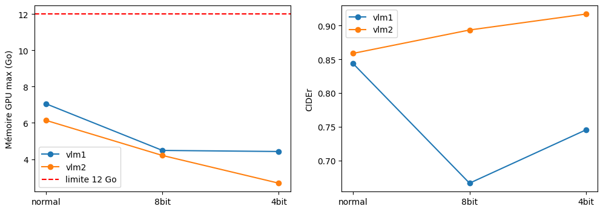
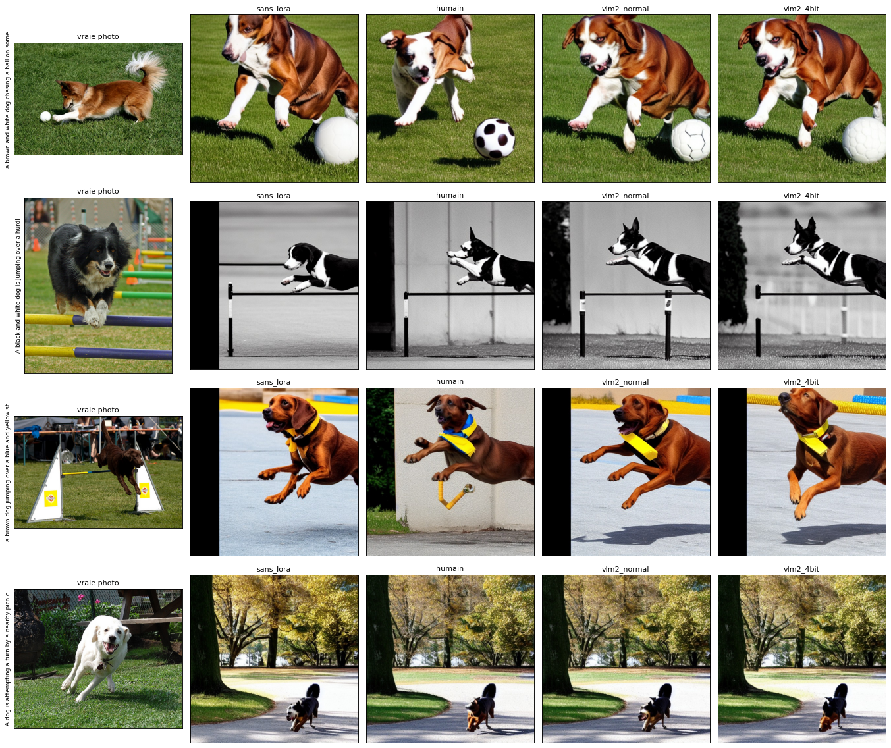

# Petits modèles vision-langage : légender ou évaluer automatiquement des images

Projet 7 — IA générative visuelle.

Nous utilisons **deux petits VLM** (modèles vision-langage) pour **légender** des images
ou **évaluer** des images générées, et nous comparons chaque modèle en
**précision normale, 8 bits et 4 bits**. Tout fonctionne sur Google Colab ou Kaggle
avec **12 Go de VRAM au maximum**.

- **Option A (notre choix)** : créer des légendes pour entraîner une LoRA.
  Nous comparons une LoRA de Stable Diffusion 1.5 entraînée avec des légendes
  humaines et avec des légendes de VLM (précision normale et 4 bits).
- Option B (non retenue) : comparer le jugement du VLM avec celui d'humains.

## Équipe

| Membre | Rôle principal |
|---|---|
| À compléter | Données |
| À compléter | Modèles et quantification |
| À compléter | Évaluation |
| À compléter | Démo et rapport |

## Organisation du dépôt

```
README.md      Présentation, installation, lancement, résultats
notebooks/     01_donnees, 02_baseline, 03_modeles, 04_evaluation, 05_demo, 06_lora
src/           Code réutilisable (données, modèles, légendes, mesures, LoRA)
configs/       Paramètres des expériences (YAML)
data/          Script de téléchargement et fiche des données (pas d'images)
results/       Figures, tableaux et exemples générés
demo/          Application de démonstration et courte vidéo
report/        Rapport final (6 à 8 pages)
docs/          Analyse des besoins, licences, fiche du modèle, réflexion éthique
```

## Installation

Sur Google Colab ou Kaggle (GPU activé) :

```bash
git clone https://github.com/doaemalak/VLMs-l-gers-pour-l-gender-ou-juger-des-images.git
cd VLMs-l-gers-pour-l-gender-ou-juger-des-images
pip install -r requirements.txt
```

## Lancement

L'ordre de travail (sur Colab, GPU T4) :

| Notebook | Rôle |
|---|---|
| `01_donnees` | Télécharger Flickr8k et tirer 500 images (graine 42) |
| `02_baseline` | VLM 1 en précision normale : la référence |
| `03_modeles` | Les 6 configurations (2 VLM × 3 précisions) sur les 500 images |
| `04_evaluation` | Graphiques mémoire / CIDEr et exemples de légendes |
| `06_lora` | Option A : préparer les données, entraîner 3 LoRA, générer et comparer |
| `05_demo` | Application Gradio (légende / score, et génération avec LoRA) |

Les résultats sont enregistrés dans Google Drive (`projet7_results`, relié à `results/`) ;
les étapes déjà faites sont sautées si Colab coupe.

En ligne de commande :

```bash
python data/download.py --config configs/data.yaml                      # données
python -m src.run_captions --config configs/vlm1.yaml --precision 4bit   # légendes
python -m src.lora_data --config configs/lora.yaml                      # données LoRA
python -m src.train_lora --source vlm2_4bit                             # une LoRA
python demo/app.py --share                                              # démo
```

Précisions disponibles : `normal`, `8bit`, `4bit`.

Un guide détaillé de chaque étape est dans `docs/guide_explicatif.pdf`.

## Résultats principaux

### 1. Les VLM : qualité, mémoire et vitesse (500 images Flickr8k, GPU T4)

| Modèle | Précision | Mémoire GPU max (Go) | Temps / image (s) | CIDEr | Remarques |
|---|---|---|---|---|---|
| VLM 1 (Qwen2.5-VL-3B) | normale | 7,05 | 0,90 | 0,844 | Référence |
| VLM 1 | 8 bits | 4,48 | 3,75 | 0,667 | Forte baisse de qualité, le plus lent |
| VLM 1 | 4 bits | 4,42 | 1,32 | 0,746 | Baisse de qualité |
| VLM 2 (SmolVLM) | normale | 6,14 | 1,44 | 0,859 | |
| VLM 2 | 8 bits | 4,20 | 2,46 | 0,894 | Pas de perte |
| VLM 2 | 4 bits | 2,68 | 1,60 | 0,917 | Pas de perte, mémoire divisée par 2,3 |

- Les 6 configurations restent **sous 12 Go**.
- La quantification réduit la mémoire de 37 % (VLM 1) à 56 % (VLM 2) en 4 bits.
- Son effet sur la qualité **dépend du modèle** : le VLM 1 perd, le VLM 2 non.
- Seul le modèle de langage est quantifié ; l'encodeur d'images reste en float16.



### 2. Option A : des légendes de VLM pour entraîner une LoRA

3 LoRA de Stable Diffusion 1.5, entraînées sur les **mêmes 93 photos de chiens**,
avec des légendes **humaines**, du **VLM 2 normal** ou du **VLM 2 4 bits**
(13 min et 4,45 Go par LoRA). Évaluation sur 23 phrases jamais vues × 2 graines.

| Condition | CLIP texte | Ressemblance aux vraies photos | vs sans LoRA (p-value) |
|---|---|---|---|
| Sans LoRA | 28,62 | 76,97 | |
| LoRA humain | 28,53 | **79,38** | +2,42 (p = 0,0006) |
| LoRA VLM 2 normal | 28,37 | **79,06** | +2,10 (p = 0,017) |
| LoRA VLM 2 4 bits | 28,52 | **78,62** | +1,65 (p = 0,045) |

**Conclusion :** les 3 LoRA apprennent le style des photos sans abîmer le respect du
texte. Les légendes du VLM en précision normale sont aussi utiles que des légendes
humaines (écart non significatif) ; en 4 bits, l'essentiel du gain est conservé avec
une légère baisse. Avec 6 tests, seuls les résultats à p < 0,008 résistent à la
correction de Bonferroni : les autres sont des tendances.



> Les figures sont produites dans Google Drive par les notebooks ; les copier dans
> `results/` pour qu'elles s'affichent ici.

## Règles de travail

- Ne pas déposer de gros fichiers de données ou de modèles dans Git.
- Faire des commits réguliers avec des messages précis.
- Utiliser des issues pour répartir les tâches.
- Chaque membre contribue de manière visible.
